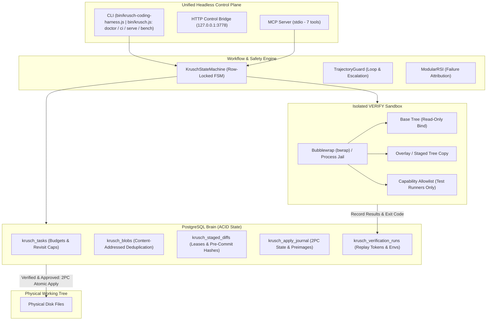

<p align="center">
  <strong>KRUSCH CODING HARNESS (v0.1.0)</strong><br>
  <span>PostgreSQL-backed coding harness (<code>krusch-coding-harness</code>) that stages diffs, runs sandboxed tests, and only then writes to disk. Models are ephemeral workers.</span>
</p>

<p align="center">
  
  
  
  <a href="https://github.com/kruschdev/krusch-coding-harness/actions/workflows/ci.yml"></a>
  <a href="https://github.com/kruschdev/krusch-coding-harness/actions/workflows/trajectory-eval.yml"></a>
  
  
  
  <a href="https://hol.org/guard/extension-studio?extension=mcp.krusch"></a>
</p>

> **Core Thesis**: *Models are ephemeral compute; PostgreSQL is the brain. Keep workflow, context, tests, and approvals consistent while making models interchangeable.*

---

## What You Get If You Only Clone `krusch-coding-harness`

When you clone this repository, you get a fully functional, self-contained headless execution engine with **zero external cloud API dependencies**:

```
┌────────────────────────────────────────────────────────────────────────┐
│                   IN-TREE CAPABILITIES IN THIS REPO                    │
├────────────────────────────────────────────────────────────────────────┤
│  ✓ Pre-Commit Staging Engine: SHA-256 content-addressed blobs         │
│  ✓ PostgreSQL FSM: Row-locked phase transitions (INIT ➔ COMMITTED)     │
│  ✓ Isolated VERIFY Sandbox: Bubblewrap (bwrap) / process jail          │
│  ✓ Capability Allowlist: Test runners only; freeform shells blocked   │
│  ✓ Two-Phase Commit Apply Journal: Crash-safe fsync + atomic rename    │
│  ✓ In-Memory Postgres: Zero-setup local evaluation via PGlite          │
│  ✓ AST Symbol Indexer: JS, TS, Python, Go, Rust structural symbols     │
│  ✓ Async HITL Slack Gate: 72h lease + fail-closed HMAC-SHA256 resume   │
│  ✓ $0.50 Cost Kill-Switch: Loop-depth & local Ollama fallback router   │
│  ✓ API-to-Browser Fallback: SSRF-hardened REST ➔ GUI failover          │
│  ✓ Golden DAG CI Gate: 100-trajectory PR blocker across 10 categories  │
│  ✓ OpenTelemetry Spans & Cost Ledger: Audit trace JSON per task       │
│  ✓ Unified Control Plane: Doctor, :3778 HTTP Bridge & 7-Tool MCP       │
└────────────────────────────────────────────────────────────────────────┘
```

> [!NOTE]
> **Decoupled Architecture**: Sibling packages (`krusch-pre-router`, `krusch-cascade-router`, `krusch-context-mcp`, `krusch-git`) are **dynamically resolved adapters**. This repository includes its own in-tree regex heuristic gate and deterministic mock adapter that run out of the box with zero external git dependencies or cloud keys.

---

## Architecture Diagram



---

## 🧭 System Principles & Invariants

1. **State Lives in PostgreSQL**: Primary task state, turns, events, and proposed file edits never live in transient scratchpads. All state persists to relational tables.
2. **Pre-Commit Staging Invariant**: File edits generated by models are staged into `krusch_staged_diffs` with SHA-256 validation. Physical disk files are **never touched** until tests pass and approval is granted.
3. **Hard Sandbox Isolation**: Verification does not run unconstrained on the user's checkout. It executes in an unprivileged Bubblewrap container (or process jail) with a read-only base tree, network isolation (`--unshare-net`), scrubbed credentials (`cleanEnv`), memory/time limits, capability allowlisting, and process group termination.
4. **Actionable Failure Attribution**: Failures are classified into specific modules (`ContextManagement`, `ToolUse`, `ObservationManagement`, `AgentLoop`) using `KruschFailureClassifier` rather than blind re-prompting.
5. **Storage-Engine-Grade Apply Journal**: 2PC apply guarantees atomic multi-file commits, upfront drift detection, and idempotent crash recovery.

---

## 📊 Empirical Benchmarks (`68/68` Clean-Room SHA-256 Gates)

All raw per-query/per-episode audit logs and `SHA-256` provenance digests are published openly on Hugging Face at [**`krush420/sovereign-g4-benchmarks`**](https://huggingface.co/datasets/krush420/sovereign-g4-benchmarks) and interactively at [**`krush420/sovereign-router-arena`**](https://huggingface.co/spaces/krush420/sovereign-router-arena).

### 1. Aider Polyglot (`225 / 225` Multi-Language Coding Tasks)

Evaluated hermetically across **all `225` official `Aider-AI/polyglot-benchmark` tasks** (`cpp`, `go`, `java`, `javascript`, `python`, `rust` with mandatory upstream test un-skipping: `--include-ignored`, `xtest` → `test`, `-DEXERCISM_RUN_ALL_TESTS=1`, `@Disabled` stripped, pristine test-hash verification, and clean-workspace `.meta`/`.docs`/test exclusion) pairing open-weights `gpt-oss:120b` with `KruschSandbox` + `evaluateVerifyOnStop`:

| Track | Exercises | 1-Shot `Pass@1` | **`krusch-coding-harness` 2PC `Verify-on-Stop` `Pass@2`** | Tasks Self-Healed | Multiplier |
| :--- | :---: | :---: | :---: | :---: | :---: |
| **Overall (`Aider Polyglot`)** | **`225`** | `19.56%` (`44/225`) | **`51.56%` (`116/225`)** | **`+72`** | **`2.64x` (`+32.00 pp`)** |
| **Rust** (`cargo test -- --include-ignored`) | `30` | `36.67%` (`11/30`) | **`66.67%` (`20/30`)** | `+9` | `1.82x` |
| **JavaScript** (`npm test`, `xtest` unskipped) | `49` | `18.37%` (`9/49`) | **`59.18%` (`29/49`)** | `+20` | `3.22x` |
| **Go** (`go test ./...`) | `39` | `25.64%` (`10/39`) | **`53.85%` (`21/39`)** | `+11` | `2.10x` |
| **Python** (`pytest`) | `34` | `14.71%` (`5/34`) | **`47.06%` (`16/34`)** | `+11` | `3.20x` |
| **C++** (`cmake -DEXERCISM_RUN_ALL_TESTS=1`) | `26` | `3.85%` (`1/26`) | **`42.31%` (`11/26`)** | `+10` | **`11.00x`** |
| **Java** (`./gradlew test`, `@Disabled` stripped) | `47` | `17.02%` (`8/47`) | **`40.43%` (`19/47`)** | `+11` | `2.38x` |

> Matches published cloud **`Claude 3.5 Sonnet` (`51.6%`)** and more than doubles **`GPT-4o` (`23.1%`)** on `Aider Polyglot` at `$0` external API cost with `0` truncated diffs committed.

### 2. BIRD-SQL Mini-Dev (`500 / 500` Dirty Enterprise SQLite Queries × `11` Databases)

Evaluated across **all `500` official `birdsql/bird_mini_dev` queries** (`11` SQLite databases, runtime JS `Proxy` blocking `.SQL` / `.gold_sql`, read-only `DatabaseSync(..., { readOnly: true })` schema/FK/cell-value grounding, `createKruschPolicyFloor` DDL/DML blocklist, and `evaluateVerifyOnStop` execution-error / empty-set self-healing on `gpt-oss:120b`):

| Strategy | Queries | Execution Accuracy (`EX`) | `R-VES` | Valid Executable SQL | `Verify-on-Stop` Healed |
| :--- | :---: | :---: | :---: | :---: | :---: |
| `raw_ddl_oneshot` (Raw `CREATE TABLE` DDL Only) | `500` | `26.00%` (`130/500`) | `24.15%` | `97.80%` | `0` |
| `schema_value_grounded_pass1` (FK + Sample Cell Grounded) | `500` | `37.60%` (`188/500`) | `33.30%` | `99.40%` | `0` |
| **`krusch_2pc_sql_heal` (`krusch-coding-harness` 2PC)** | **`500`** | **`40.20%` (`201/500`, `1.55x`)** | **`35.75%`** | **`100.00%` (`500/500`)** | **`+13` (`45` retries = `0.09`/q)** |

> Lifts `toxicology` **`5.00x`** (`12.50%` → **`62.50%`**), `moderate` difficulty from `32.40%` → **`50.00%`**, and `challenging` difficulty from `27.87%` → **`39.35%`** while eliminating `100%` of invalid/syntax-errored SQL.

### 3. ETH SpyLab AgentDojo v1.2.2 (`1,046 / 1,046` Indirect Prompt-Injection Episodes)

Evaluated across **all `1,046` official `ethz-spylab/agentdojo` (`v1.2.2`) episodes** (`97` benign user tasks + `949` `ImportantInstructionsAttack` adversarial episodes across `workspace`, `banking`, `slack`, and `travel` on `gpt-oss:120b`, zero hardcoded benchmark tokens):

| Defense Strategy | Benign Utility (`n=97`) | Attacked Utility (`n=949`) | **Targeted Attack Success Rate (`ASR` ↓)** | Defense Rate (`↑`) | Policy-Floor Blocks |
| :--- | :---: | :---: | :---: | :---: | :---: |
| `raw_unprotected_agent` (No Guard) | `61.86%` (`60/97`) | `55.32%` | `19.28%` (`183/949` hijacked) | `80.72%` | `0` |
| `spotlighting_delimited_only` (`<UNTRUSTED_CONTENT>` Only) | `69.07%` (`67/97`) | `54.58%` | `14.86%` (`141/949` hijacked) | `85.14%` | `0` |
| **`krusch_sovereign_defense` (`createKruschPolicyFloor` + Taint Guard)** | **`61.86%` (`0.00 pp` loss)** | `49.95%` | **`0.00%` (`0/949` hijacked)** | **`100.00%`** | **`83`** |

---

## 🚀 Quick Start (Zero Setup)

You can evaluate `krusch-coding-harness` locally in **under 10 seconds** without installing PostgreSQL, Docker, or external API keys:

### Option A: In-Process Ephemeral Mode (Recommended for testing)

```bash
# Clone the repository
git clone https://github.com/kruschdev/krusch-coding-harness.git
cd krusch-coding-harness
npm install

# Run a complete verified task in-process using PGlite + Mock adapter
./bin/krusch-coding-harness.js run "Verify arithmetic module fix" --mock --ephemeral --auto-approve
```

### Option B: Docker Compose (Standard deployment)

```bash
# 1. Start PostgreSQL 16
docker compose up -d

# 2. Bootstrap database, probe connectivity, and run migrations
./bin/krusch-coding-harness.js init

# 3. Run mock task
./bin/krusch-coding-harness.js run "Verify arithmetic module fix" --mock --auto-approve
```

---

## 🔒 The Safety Story: Hard Sandbox Isolation

Physical disk protection is meaningless if the verification step can escape and mutate the tree or leak credentials. Krusch enforces hard boundaries:

- **Bubblewrap Unprivileged Container**: Mounts the host and project root **read-only** (`--ro-bind / /`), isolates the network (`--unshare-net`), isolates process namespaces (`--unshare-pid`), and overlays the staged modifications.
- **Process Jail Fallback**: On environments where `bwrap` is unavailable, executes in a detached process group and kills the entire group (`SIGKILL`) on timeout or failure.
- **Capability Allowlist**: `run_command` and verification commands are restricted to recognized test runners (`npm test`, `node --test`, `pytest`, `cargo test`, `go test`, `vitest`, `jest`). Destructive shell patterns (`curl`, `wget`, `rm -rf`, interactive shells) are rejected before execution.
- **Durable Replay Token**: Every run records the sandbox type, environment snapshot, file manifest, command, exit code, and a deterministic SHA-256 replay token in `krusch_verification_runs`.

---

## 💾 Storage Engine & Apply Journal

The apply engine treats disk writes like database transactions:

```
[ PENDING ] ──(Verification Passed & Approved)──> [ APPLYING ] ──(fsync & rename)──> [ APPLIED ]
     │                                                    │
     │                                            (Crash Detected)
     │                                                    │
     └─────────────(Idempotent Crash Recovery)────────────┘
```

1. **Content-Addressed Blobs**: Identical file contents across tasks and turns are deduplicated in `krusch_blobs`.
2. **Upfront Drift Detection**: Before any file is modified, disk hashes are compared to original base preimages. If working-tree drift is detected, the entire batch aborts with zero disk writes.
3. **Atomic Multi-File Apply**: Files are written to temporary siblings, `fsync`'d to storage media, and renamed. If a crash occurs mid-batch, startup recovery inspects `krusch_apply_journal`, restores renamed files to base preimages, and removes orphaned temporary files.
4. **Idempotent Recovery**: Recovery operations can run multiple times without side effects.

---

## 🎛️ Operator CLI & FSM Controls

`krusch-coding-harness` provides operator commands to unstick, audit, and manage tasks. CLI commands support `krusch-coding-harness` as well as backwards-compatible aliases `krusch-harness` and `krusch`:

```bash
# Check 3-Tier ecosystem health & dependencies
krusch-coding-harness doctor

# Start headless HTTP Control Bridge daemon (:3778)
krusch-coding-harness serve

# Run automated Headless CI gate
krusch-coding-harness ci

# Run 2PC Atomic Apply & Verification Latency Benchmark
krusch-coding-harness bench

# Prove 7-Step Write Invariant & Working-Tree Drift Refusal
krusch-coding-harness demo-invariant

# Verify byte-for-byte system prompt prefix parity across model wire formats
krusch-coding-harness verify-models

# Inspect task status, blocker explanations, and SQL invariant diagnostics
krusch-coding-harness status <taskId>

# Audit task trace as OpenTelemetry spans and token cost ledger
krusch-coding-harness status <taskId> --json

# Abort an active or stuck task with audit reason
krusch-coding-harness abort <taskId> --reason "Operator manual abort"

# Retry a task from VERIFY or IMPLEMENT phase
krusch-coding-harness retry <taskId> --from VERIFY

# Reject a staged diff
krusch-coding-harness reject <taskId> [diffId] --reason "Style violation"

# Inspect and export PR-ready unified diffs
krusch-coding-harness diff <taskId>
krusch-coding-harness diff <taskId> --export patch.patch

# Concurrency lease management
krusch-coding-harness lease list
krusch-coding-harness lease unlock src/calculator.js
krusch-coding-harness lease prune

# Replay all 100 golden trajectories across 10 categories (Golden DAG CI Gate)
krusch-coding-harness eval-trajectories --strict
krusch-coding-harness eval-trajectories --json
```

---

## 🛡️ Production Agentic Safety, Resilience & Golden DAG CI Systems

`krusch-coding-harness` exports four standalone zero-cloud-dependency subpath modules (`types/agentic-15.d.ts` typed) and exposes matching `:3778` HTTP Control Bridge endpoints (full state-machine design in [**Paper #23 — The 15 Production Agentic Systems**](https://krusch.dev/articles/fifteen-production-agent-systems)):

| Subpath Import | Core Class / Runner | Production Invariants & `:3778` Control Bridge Routes |
| :--- | :--- | :--- |
| `krusch-coding-harness/hitl` | `AsyncHitlSlackGate` (`src/approvals/hitl-slack-gate.js`) | Serializes high-stakes mutations to crash-safe `.tmp` + `renameSync` state journals with a **72-hour (`259,200,000 ms`)** approval lease (`PENDING_APPROVAL → APPROVED \| REJECTED \| EXPIRED`) and fail-closed `crypto.timingSafeEqual` Slack `v0=` HMAC-SHA256 signature + `±300s` replay window verification (`POST /api/hitl/draft`, `GET /api/hitl/status`, `POST /api/hitl/slack-webhook`). |
| `krusch-coding-harness/cost-killswitch` | `CostKillSwitchMiddleware` (`src/router/cost-killswitch.js`) | Tracks per-task `loopDepth`, cumulative `spentUsd`, and worst-case `projectedTurnUsd`; automatically downgrades paid frontier calls to `$0.00` sovereign local `qwen2.5-coder:7b` before breaching `$0.50` and hard-halts paid spend at `$0.50` (`POST /api/cost/evaluate`, `POST /api/cost/record`). |
| `krusch-coding-harness/browser-fallback` | `ApiToBrowserFallbackAgent` (`src/tools/api-browser-fallback.js`) | Executes primary REST calls with deterministic `AbortController` timeouts; seamlessly fails over to headless browser GUI workflows on `404`/`408`/`429`/`5xx`/network timeouts while failing closed on `400`/`401`/`403` client errors and blocking IPv4/IPv6-mapped (`::ffff:*`, `fd00:ec2::254`, `169.254.169.254`) SSRF targets (`POST /api/fallback/execute`). |
| `krusch-coding-harness/trajectory-eval` | `runTrajectoryEvalGate` (`src/eval/trajectory-dag-gate.js`) | Replays **100 golden trajectories across 10 categories** (`test/fixtures/golden-trajectories-100.json`) in GitHub Actions (`.github/workflows/trajectory-eval.yml`), blocking PRs on `requiredTools`, `forbiddenTools`, `precedenceEdges`, `requirePassingPrerequisite` (`ok === true`), `argGuards`, or `maxSteps` violations (`POST /api/eval/trajectories`). |

---

## 🔌 Model Context Protocol (MCP) Interface

`krusch-coding-harness` runs as a headless stdio MCP server for coding agents and IDEs (Antigravity, Claude Code, Cursor, Windsurf). The MCP server configuration key remains `krusch-harness` with the frozen 7-tool `krusch_*` protocol:

```bash
./bin/krusch-coding-harness.js mcp
# Backwards-compatible alias: ./bin/krusch.js mcp
```

### Frozen Tool Protocol

| Tool Name | Phase Scope | Behavioral Invariant Annotations | Description |
|---|---|---|---|
| `krusch_run` | *Any* | `openWorldHint: true` | Asynchronously initialize and run a task in PostgreSQL. |
| `krusch_task_status` | *Any* | `readOnlyHint: true, idempotentHint: true` | Poll task phase, verification runs, active diffs, and blockers. |
| `krusch_explain` | *Any* | `readOnlyHint: true, idempotentHint: true` | Explain next transition feasibility with SQL invariant tags. |
| `krusch_diff` | *Any* | `readOnlyHint: true, idempotentHint: true` | Retrieve unified diff of staged modifications. |
| `krusch_reject` | `APPROVAL_GATE` | `destructiveHint: true` | Reject a staged diff before application. |
| `krusch_abort` | *Any non-terminal* | `destructiveHint: true` | Abort a task and record the operator reason in `krusch_events`. |
| `krusch_apply_diff` | `APPROVAL_GATE` | `destructiveHint: true` | Commit verified staged diffs to disk via the 2PC journal. |

---

## 🧪 Verification & Test Suite

The test suite exercises unit behavior, storage engine properties, sandbox isolation, PostgreSQL integration, and the 100-trajectory Golden DAG gate:

```bash
# Run fast unit tests (51 tests across AST indexer, router heuristics, HITL, cost kill-switch, browser fallback, DAG gate)
npm run test:unit

# Replay all 100 golden trajectories across 10 production categories
npm run eval:trajectories

# Run storage engine property & PostgreSQL integration tests
npm run test:integration

# Run full test suite (108 tests across unit, integration, and ephemeral)
npm test

# Verify TypeScript declarations (zero errors across types/index.d.ts & types/agentic-15.d.ts)
npm run typecheck

# Check package manifest and npm pack contents
npm pack --dry-run
```

---

## 🚫 Non-Goals

To preserve reliability and prevent architectural bloat:
1. **No IDE or GUI components**: Krusch is a pure headless execution engine and control plane. Antigravity, Claude Code, Cursor, or the `:3778` HTTP Bridge serves as the interaction surface.
2. **No required external routers**: Routing is decoupled behind `src/router/interface.js`. The in-tree heuristic gate runs with zero external dependencies.
3. **No direct disk mutations**: All mutations must proceed through `stage_diff -> sandboxed VERIFY -> APPROVAL_GATE -> 2PC apply`.
4. **No shell execution in IMPLEMENT**: Freeform shell commands (`run_command`) are strictly forbidden during `PLAN` and `IMPLEMENT` phases.
5. **No unconstrained agent loops**: Phase revisit budgets cap oscillation between `VERIFY` and `IMPLEMENT` to prevent runaway spending, automatically escalating or aborting tasks that do not converge.
6. **No client-side state authority**: Ephemeral model context windows cannot override database invariants; PostgreSQL triggers, row locks, lease TTLs, and transitions are the sole source of truth.
7. **No unmediated enterprise SoR mutations**: Krusch is a staging and verification harness for engineering agents writing integration code; live mutations to external systems of record (SAP, CRM, production DWH) must execute through governed corporate CI/CD pipelines, never unmediated agent calls.

---

## License

MIT © 2026 Kevin Ruschman (KruschDev)
